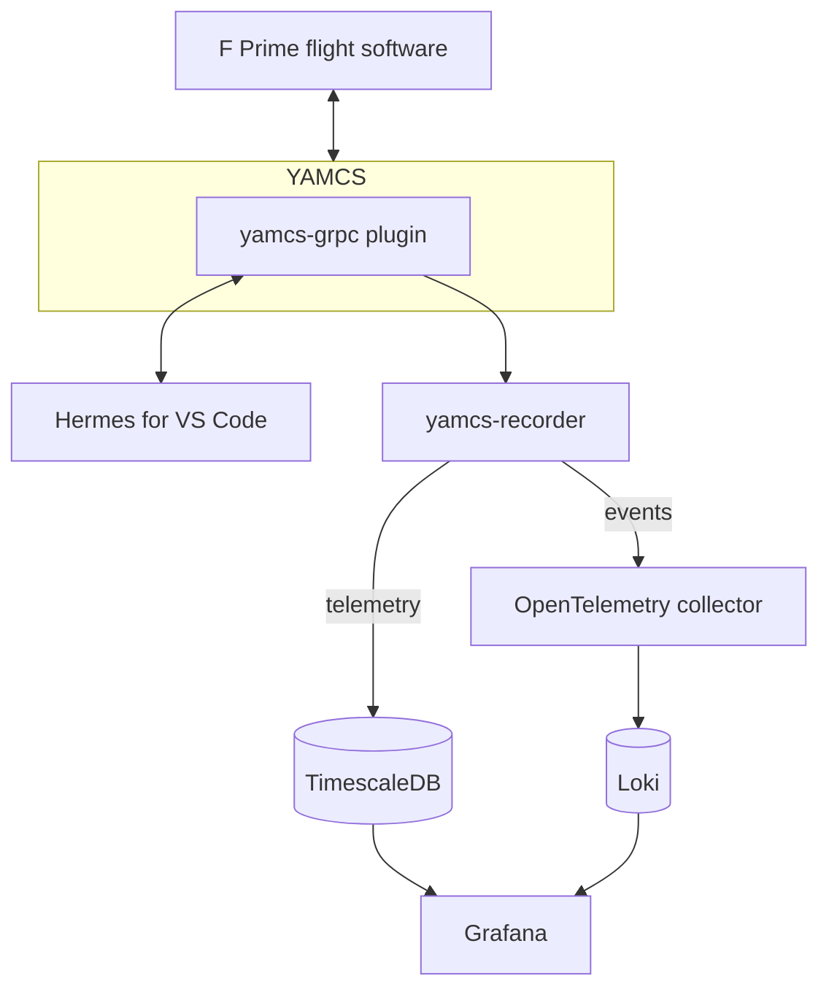

<h2 align="center">Hermes, A Lightweight Telemetry and Commanding Framework</h2>
<p align="center"><br/>

</p>

Hermes lets you command spacecraft flight software and watch its telemetry from VS Code, then chart what was recorded
in Grafana. It talks to flight software through [YAMCS](https://yamcs.org), an open-source mission control server, and
has built-in support for [F Prime](https://github.com/nasa/fprime), NASA's flight software framework. Hermes is
developed at [NASA JPL](https://www.jpl.nasa.gov).

The [documentation site](https://nasa.github.io/hermes/) still describes an earlier Hermes that doesn't use YAMCS. To
use Hermes with YAMCS, follow the READMEs linked below.


## What you can do

- Send commands from VS Code notebook cells, with completion, argument checks and a live status for each command.
- Watch live telemetry and events in Hermes's telemetry table, plot and events panel in VS Code.
- Record telemetry and events, then chart the telemetry and search the events in Grafana.
- Write commands and read events by their F Prime names when
  [fprime-yamcs](https://github.com/fprime-community/fprime-yamcs) runs YAMCS for your F Prime deployment, the flight
  software you build with F Prime. For example, `CdhCore.cmdDisp.CMD_NO_OP` instead of the YAMCS path
  `/Ref_Ref/CdhCore/cmdDisp/CMD_NO_OP`.

## How it fits together



| Component | What it does | Docs |
| --- | --- | --- |
| yamcs-grpc plugin | Runs inside YAMCS and serves YAMCS's API over gRPC, a protocol for calling a server's methods | [yamcs-grpc-plugin/](yamcs-grpc-plugin/README.md) |
| Hermes (VS Code extension) | Telemetry table and plot, events panel, notebooks with YAMCS command cells, and the YAMCS connection | [src/extensions/core/](src/extensions/core/README.md) |
| Hermes FPrime (VS Code extension) | F Prime command cells and sequence files | [src/extensions/fprime/](src/extensions/fprime/README.md) |
| yamcs-recorder | Writes telemetry to TimescaleDB, a PostgreSQL database for time series. Can also send events through an OpenTelemetry collector, which forwards them to Loki, a log database. | [cmd/yamcs-recorder/](cmd/yamcs-recorder/README.md) |
| Hermes datasource (Grafana plugin) | Charts the telemetry yamcs-recorder writes to TimescaleDB | [User guide](grafana-datasource-plugin/src/README.md), [Development](grafana-datasource-plugin/README.md) |
| fprime-yamcs (external) | Runs YAMCS for an F Prime deployment | [fprime-community/fprime-yamcs](https://github.com/fprime-community/fprime-yamcs) |

## Getting started

| You need | For |
| --- | --- |
| Docker | Building the yamcs-grpc plugin, stock YAMCS, and the databases |
| A POSIX shell, such as Git Bash or WSL on Windows | The commands in these READMEs |
| Node.js and yarn | Building the VS Code extensions |
| VS Code | Running them |
| Go 1.26 or newer | Building yamcs-recorder |
| [Mage](https://magefile.org), a make-like build tool for Go | Building the Hermes datasource for Grafana |

Each step links to the README with the commands.

1. Build the yamcs-grpc plugin ([Build](yamcs-grpc-plugin/README.md#build)).
2. Start YAMCS with the plugin. A YAMCS server runs one or more instances, each with its own commands, telemetry and
   archive. Later steps ask for your instance's name.
   - For an F Prime deployment, use fprime-yamcs ([With fprime-yamcs](yamcs-grpc-plugin/README.md#with-fprime-yamcs)).
     Its instance is `fprime-project`.
   - To try Hermes without F Prime, use stock YAMCS ([With stock YAMCS](yamcs-grpc-plugin/README.md#with-stock-yamcs)).
     Its instance, `simulator`, runs YAMCS's demo spacecraft simulator.
3. Run the VS Code extensions ([Develop](src/extensions/core/README.md#develop)) and connect them to YAMCS
   ([Connect](src/extensions/core/README.md#connect)).

Steps 1 to 3 are enough to command and watch telemetry in VS Code. To record telemetry and events and view them in
Grafana:

4. Start the databases and Grafana. From the repository root, start Loki and the OpenTelemetry collector:

   ```sh
   docker compose up -d loki otel-collector
   ```

   Then start TimescaleDB and Grafana with the Hermes datasource's development setup
   ([Develop](grafana-datasource-plugin/README.md#develop)). The Grafana in `docker-compose.yml` doesn't start yet,
   because no Hermes release has this version of the datasource for it to download.

5. Start yamcs-recorder with `--instance` set to your instance ([Run](cmd/yamcs-recorder/README.md#run)).
6. Open Grafana at [localhost:3000](http://localhost:3000). Chart telemetry with the Hermes datasource
   ([user guide](grafana-datasource-plugin/src/README.md#3-query-data)) and search events with a Loki datasource
   ([Query events in Grafana](cmd/yamcs-recorder/README.md#query-events-in-grafana)).

### Ports

| Port | Service | Started in | Used by |
| --- | --- | --- | --- |
| 8090 | YAMCS web interface and HTTP API | Step 2 | Your browser |
| 8091 | yamcs-grpc plugin | Step 2 | VS Code, yamcs-recorder |
| 5432 | TimescaleDB (database `hermes`, user `postgres`, password `password`) | Step 4 | yamcs-recorder writes, Grafana reads |
| 4317 | OpenTelemetry collector, receiving OTLP (the OpenTelemetry protocol) over gRPC | Step 4 | yamcs-recorder, when it sends events |
| 3100 | Loki | Step 4 | The collector, Grafana |
| 3000 | Grafana | Step 4 | Your browser |
