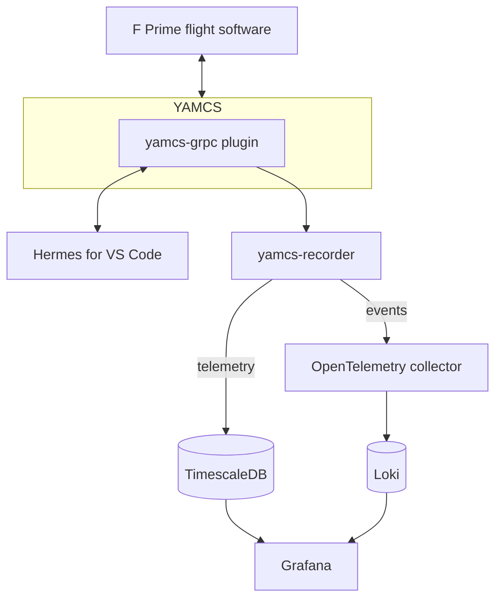

<h2 align="center">Hermes, A Lightweight Telemetry and Commanding Framework</h2>
<p align="center"><br/>

</p>

Hermes lets you command spacecraft flight software and watch its telemetry from VS Code, then chart what was recorded
in Grafana. It talks to flight software through [YAMCS](https://yamcs.org), an open-source mission control server, and
has built-in support for [F Prime](https://github.com/nasa/fprime), NASA's flight software framework. Hermes is
developed at [NASA JPL](https://www.jpl.nasa.gov).

The [documentation site](https://nasa.github.io/hermes/) hasn't been updated for YAMCS yet.


## What you can do

- Send commands from VS Code notebook cells, with completion, argument checks and a live status for each command.
- Watch live telemetry and events in Hermes's telemetry table, plot and events panel in VS Code.
- Record telemetry and events, then chart the telemetry and search the events in Grafana.
- Write commands and read events by their F Prime names, for example `CdhCore.cmdDisp.CMD_NO_OP`, when
  [fprime-yamcs](https://github.com/fprime-community/fprime-yamcs) runs YAMCS for your F Prime deployment.

## How it fits together



| Component | What it does | Docs |
| --- | --- | --- |
| yamcs-grpc plugin | Runs inside YAMCS and serves YAMCS's API over gRPC | [yamcs-grpc-plugin/](yamcs-grpc-plugin/README.md) |
| Hermes (VS Code) | Telemetry table and plot, events panel, notebooks, and the YAMCS connection | [src/extensions/core/](src/extensions/core/README.md) |
| Hermes YAMCS (VS Code) | YAMCS command cells | [src/extensions/yamcs/](src/extensions/yamcs/README.md) |
| Hermes FPrime (VS Code) | F Prime command cells and sequence files | [src/extensions/fprime/](src/extensions/fprime/README.md) |
| yamcs-recorder | Writes telemetry to TimescaleDB and, with `--otlp`, events to Loki | [cmd/yamcs-recorder/](cmd/yamcs-recorder/README.md) |
| Hermes datasource (Grafana) | Charts the telemetry yamcs-recorder writes to TimescaleDB | [User guide](grafana-datasource-plugin/src/README.md), [developing](grafana-datasource-plugin/README.md) |
| fprime-yamcs (external) | Runs YAMCS for an F Prime deployment | [fprime-community/fprime-yamcs](https://github.com/fprime-community/fprime-yamcs) |

## Getting started

Each step links to the README with the commands. To command and watch telemetry in VS Code only, steps 1, 2 and 5 are
enough.

1. Build the yamcs-grpc plugin ([Build](yamcs-grpc-plugin/README.md#build)).
2. Start YAMCS with the plugin:
   - for an F Prime deployment, with fprime-yamcs ([With fprime-yamcs](yamcs-grpc-plugin/README.md#with-fprime-yamcs))
   - otherwise, stock YAMCS ([With stock YAMCS](yamcs-grpc-plugin/README.md#with-stock-yamcs))
3. From the repo root, start TimescaleDB, Loki, the OpenTelemetry collector and Grafana:

   ```sh
   docker compose up -d
   ```

4. Start yamcs-recorder ([Run](cmd/yamcs-recorder/README.md#run)).
5. Run the VS Code extensions ([Develop](src/extensions/core/README.md#develop)) and connect them to YAMCS
   ([YAMCS mode](src/extensions/core/README.md#yamcs-mode)).
6. Open Grafana at http://localhost:3000 and search events with its Loki datasource
   ([example queries](cmd/yamcs-recorder/README.md#query-events-in-grafana)).

> [!NOTE]
> This Grafana can't chart telemetry yet. It installs the Hermes datasource from the latest Hermes release, whose datasource
> reads different tables. To chart telemetry, run `docker compose stop grafana timescaledb` and start the datasource's
> [development setup](grafana-datasource-plugin/README.md#develop), which has its own Grafana and TimescaleDB on the
> same ports. The yamcs-recorder command stays the same.

### Ports

| Port | Service | Started by | Used by |
| --- | --- | --- | --- |
| 8091 | yamcs-grpc plugin | YAMCS (step 2) | VS Code, yamcs-recorder |
| 5432 | TimescaleDB (database `hermes`, user `postgres`, password `password`) | `docker compose` | yamcs-recorder writes, Grafana reads |
| 4317 | OpenTelemetry collector (OTLP over gRPC) | `docker compose` | `yamcs-recorder --otlp` |
| 3100 | Loki | `docker compose` | The collector, Grafana |
| 3000 | Grafana (login `admin` / `admin`) | `docker compose` | Your browser |
