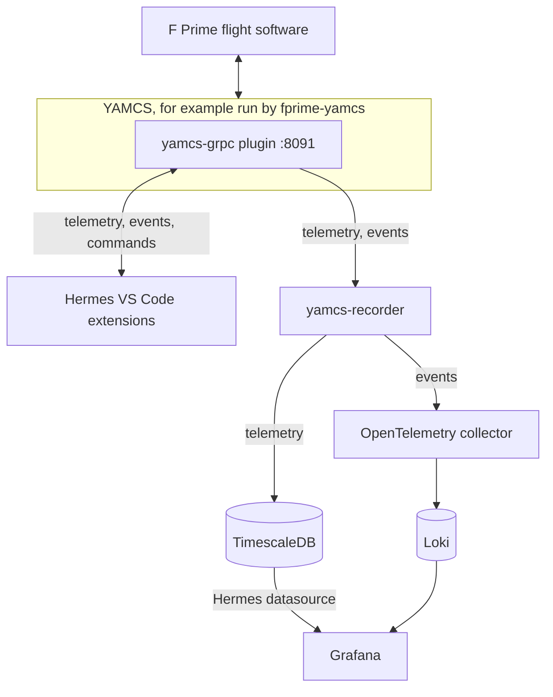

<figure markdown="span">
  
</figure>

# Hermes

Hermes lets you command spacecraft flight software and watch its telemetry from VS Code, then chart what was recorded
in Grafana. It talks to flight software through [YAMCS](https://yamcs.org), an open-source mission control server, and
has built-in support for [F Prime](https://github.com/nasa/fprime), NASA's flight software framework.

!!! warning "Build Hermes from source"

    The Hermes release on the VS Code Marketplace can't connect to YAMCS yet. These pages describe Hermes built from
    source, as in [Installation](getting-started/installation.md).

## What you can do

- Send commands from VS Code notebook cells, with completion, argument checks and a live status for each command.
- Watch live telemetry and events in VS Code, in the telemetry table and plot and the events panel.
- Write and check commands in Offline mode, before Hermes connects to YAMCS.
- Record telemetry and events, then chart the telemetry and search the events in Grafana.

## How it fits together

To command flight software and watch its telemetry in VS Code, you need YAMCS with the yamcs-grpc plugin, and the
Hermes VS Code extensions. The recorder, the databases and Grafana are optional. They keep what YAMCS receives so you
can chart it later.

| Part | What it does |
| --- | --- |
| fprime-yamcs | Starts YAMCS and your F Prime deployment (a flight software program built with F Prime), and connects the two |
| yamcs-grpc plugin | Runs inside YAMCS and serves YAMCS's API over gRPC, a protocol for calling a server over the network. Hermes connects to YAMCS through it. |
| Hermes VS Code extensions | Notebooks whose cells send commands, the telemetry table and plot, and the events panel |
| yamcs-recorder | Writes telemetry to TimescaleDB, a PostgreSQL database for time series. Sends events to Loki, a log database, through an OpenTelemetry collector, which forwards them. |
| Grafana | Charts telemetry from TimescaleDB with the Hermes datasource, and searches events in Loki |

The project README lists the [ports](https://github.com/nasa/hermes/tree/v6#ports) each part uses.

## Get started

1. [Installation](getting-started/installation.md): build the yamcs-grpc plugin and set up the Hermes VS Code
   extensions.
2. [Quick Start](getting-started/quick-start.md): run F Prime's reference flight software under YAMCS and send it a
   command from VS Code.
3. [Recording from YAMCS](tlm/recording.md), optional: record telemetry and events, then chart them in
   [Grafana](tlm/grafana.md).
