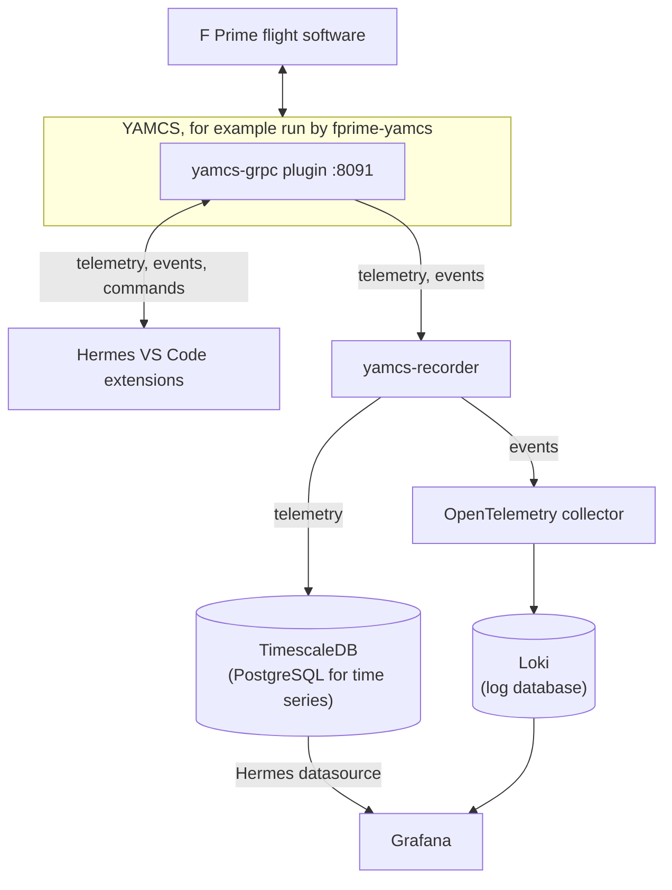

<figure markdown="span">
  
</figure>

# Hermes

Hermes lets you command spacecraft flight software and watch its telemetry from VS Code, then chart what was recorded
in Grafana. It talks to flight software through [YAMCS](https://yamcs.org), an open-source mission control server, and
has built-in support for [F Prime](https://github.com/nasa/fprime), NASA's flight software framework.

!!! warning "Hermes v6 has no release yet"

    These pages describe Hermes v6, which you build from the `v6` branch. See [Installation](getting-started/installation.md).

## What you can do

- Send commands from VS Code notebook cells, with completion, argument checks and a live status for each command.
- Watch live telemetry and events in the telemetry table, plot and events panel in VS Code.
- Write notebooks and sequences in Offline mode, without a connection. Hermes starts in Offline mode.
- Record telemetry and events, then chart the telemetry and search the events in Grafana.

## How it fits together

| Part | What it does |
| --- | --- |
| yamcs-grpc plugin | Runs inside YAMCS and serves YAMCS's API over gRPC |
| Hermes VS Code extensions | Notebooks, the telemetry table and plot, and the events panel. Hermes YAMCS and Hermes FPrime add YAMCS and F Prime command cells. |
| yamcs-recorder | Writes telemetry to TimescaleDB, and events through the OpenTelemetry collector to Loki |
| Grafana | Charts telemetry from TimescaleDB with the Hermes datasource plugin, and searches events in Loki |

The project README lists the [ports](https://github.com/nasa/hermes/tree/v6#ports) each part uses.

## Get started

1. [Installation](getting-started/installation.md): build the yamcs-grpc plugin and set up the VS Code extensions.
2. [Quick Start](getting-started/quick-start.md): run an F Prime deployment under YAMCS and send it a command from
   VS Code.
3. [Recording](tlm/recording.md): record telemetry and events, then chart them in [Grafana](tlm/grafana.md).
