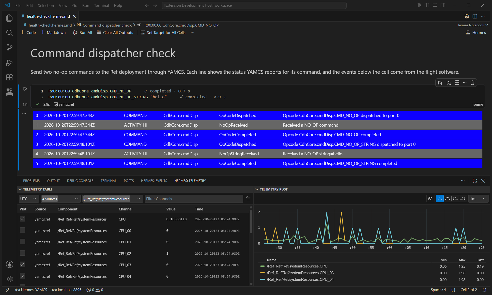
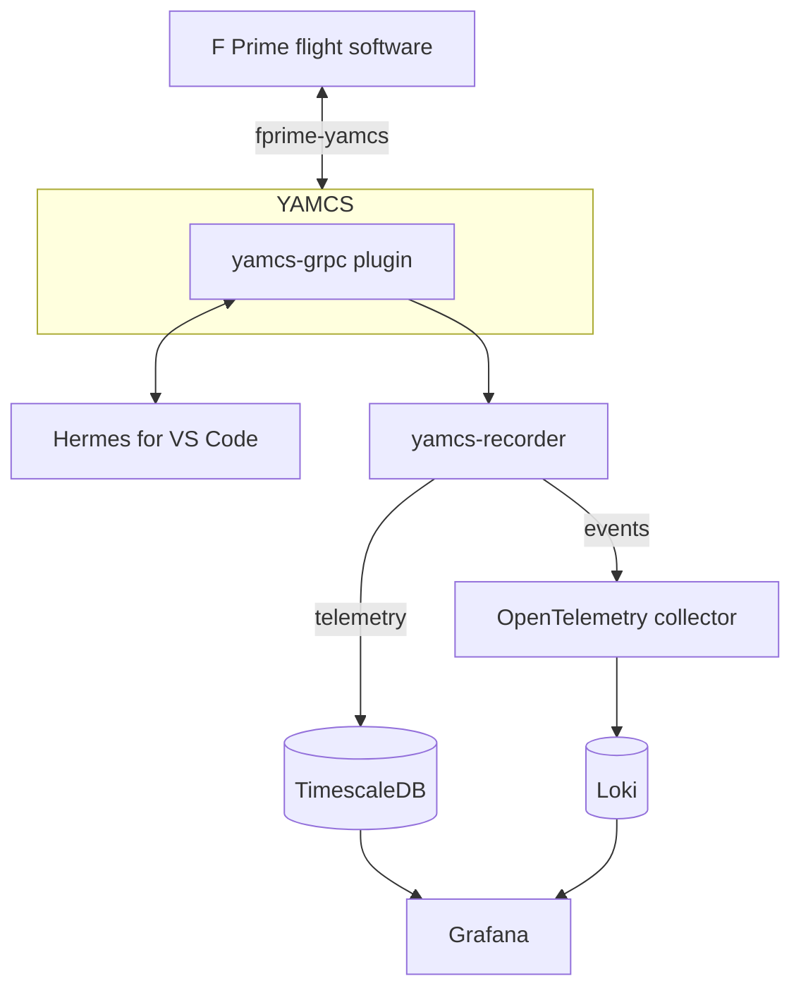

<figure markdown="span">
  
</figure>

# Hermes - A Command & Telemetry Framework

!!! warning

    Hermes is currently undergoing migration from our internal deployment to
    public Github. Documentation is currently under construction and incomplete.

Hermes is a system for spacecraft command and telemetry management, providing a modern interface for ground operators to interact with flight software. It features a [Visual Studio Code](https://code.visualstudio.com/) frontend for commanding and telemetry display, and talks to flight software through [YAMCS](https://yamcs.org), an open-source mission control server.

## Architecture

To command flight software and watch its telemetry in VS Code, you need YAMCS with the yamcs-grpc plugin, and the
Hermes VS Code extensions. The recorder, the databases and Grafana are optional. They keep what YAMCS receives so you
can chart it later.

| Part | What it does |
| --- | --- |
| fprime-yamcs | Starts YAMCS and your F Prime deployment (a flight software program built with F Prime), and connects the two |
| yamcs-grpc plugin | Runs inside YAMCS and serves YAMCS's API over gRPC, a protocol for calling a server over the network. Hermes connects to YAMCS through it. |
| Hermes VS Code extensions | Notebooks whose cells send commands, the telemetry table and plot, and the events panel |
| yamcs-recorder | Writes telemetry to TimescaleDB, a PostgreSQL database for time series. Sends events to Loki, a log database, through an OpenTelemetry collector, which forwards them. |
| Grafana | Charts telemetry from TimescaleDB with the Hermes datasource, and searches events in Loki |

We recommend reading more about the [core concepts](./arch/core-concepts.md) of Hermes to understand the context and design of the software.

## Key Features

- **Command Dispatch**: Command uplink from VS Code notebooks, with completion, argument checks and a live status for each command
- **Telemetry Display**: Real-time visualization of spacecraft telemetry data
- **File Upload**: Sends files to the flight software from VS Code, through YAMCS
- **Telemetry Recording**: Records telemetry and events, to chart and search in Grafana

## Getting Started

To get started with Hermes, see the [Installation Guide](getting-started/installation.md) and [Quick Start Guide](getting-started/quick-start.md).
