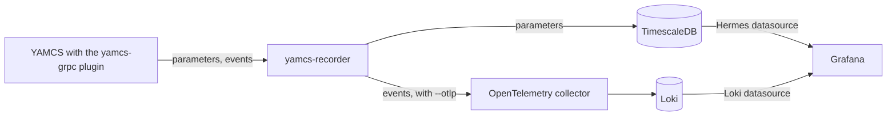

# Recording and Grafana

Hermes can record what a YAMCS instance receives, so you can chart its telemetry and search its events in Grafana.
A YAMCS server can run several instances, each with its own telemetry, commands and archive. YAMCS calls each
telemetry value a parameter.

| Part | What it does |
| --- | --- |
| yamcs-grpc plugin | A YAMCS plugin that comes with Hermes. The recorder reads from YAMCS through it. |
| yamcs-recorder | Subscribes to one YAMCS instance, writes its parameter values to TimescaleDB and, with `--otlp`, sends its events to the collector |
| TimescaleDB | A PostgreSQL database for time series. It stores the parameter values. |
| OpenTelemetry collector | Passes the recorder's events on to Loki |
| Loki | A log database. It stores the events. |
| Grafana | A web app for charts and dashboards. It reads each database through a datasource, a Grafana plugin for one kind of database. |

| Page | What it covers |
| --- | --- |
| [Recording from YAMCS](recording.md) | Starting the databases, building yamcs-recorder and having YAMCS run it |
| [Grafana](grafana.md) | Installing the Hermes datasource, charting telemetry and searching events |
