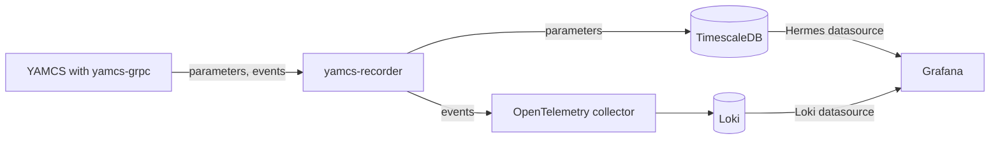

# Recording and Grafana

Hermes can record what a YAMCS instance receives, so you can chart its telemetry and search its events in Grafana.
YAMCS calls each telemetry value a parameter.

- `yamcs-recorder` subscribes to one YAMCS instance through the yamcs-grpc plugin. It writes parameter values to
  TimescaleDB and sends events through an OpenTelemetry collector to Loki.
- Grafana charts the parameters with the Hermes datasource and searches the events with its Loki datasource.
- The `docker-compose.yml` at the root of the repo starts TimescaleDB, the collector, Loki and Grafana.

| Page | What it covers |
| --- | --- |
| [Recording from YAMCS](recording.md) | Starting the databases, building yamcs-recorder and having YAMCS run it |
| [Grafana](grafana.md) | Installing the Hermes datasource, charting telemetry and searching events |
