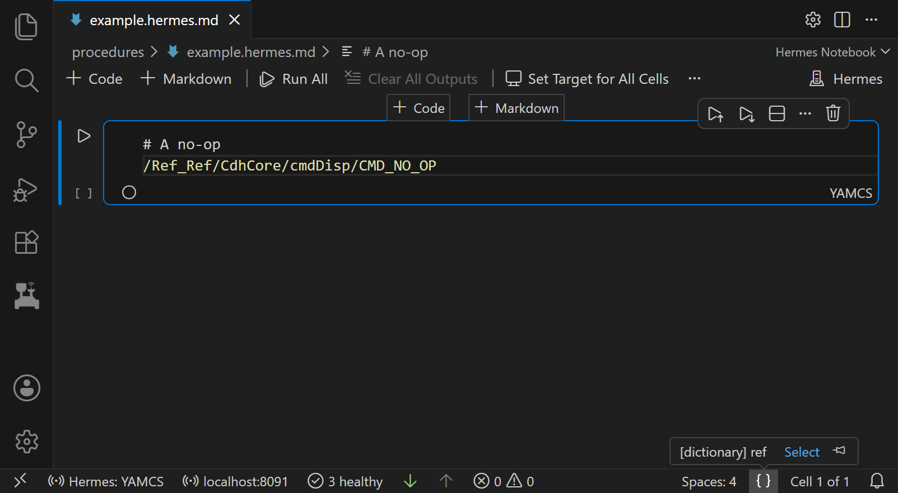

# Connect to YAMCS

Hermes reaches the flight software through YAMCS, a mission control server. Hermes has two modes:

- **Offline**, with no connection to YAMCS. You can write notebook cells, with completion and argument checks, but
  they don't run. Hermes starts in Offline mode each time VS Code starts.
- **YAMCS**, connected to YAMCS. Cells send commands, and the telemetry and events panels show live data.

## Connect

Hermes connects through the [yamcs-grpc plugin](https://github.com/nasa/hermes/tree/main/yamcs-grpc-plugin), which
runs inside YAMCS and listens on port 8091. The [Quick Start](../getting-started/quick-start.md) starts YAMCS with it.
Hermes sends no credentials, so a YAMCS server that requires a login refuses it with `UNAUTHENTICATED`.

1. Click **Hermes: Offline** in the status bar at the bottom of the window, or run **Hermes: Change Backend Mode**
   from the command palette. Hermes calls the server it connects to a backend.
2. Pick **YAMCS**.
3. Enter the plugin's address. The prompt starts with `localhost:8091`.

Hermes connects to every running YAMCS [instance](../arch/core-concepts.md#yamcs-terms) that has a `realtime`
processor, or the processor you [set](#settings). The status bar then shows **Hermes: YAMCS** and the plugin's
address. To go back, pick **Offline** in the same list.

If the connection fails or ends, for example because YAMCS stopped, the status bar turns red and Hermes works as in
Offline mode. Hover over the address to see why. Stopping or restarting one instance disconnects all of them. Run
**Hermes: Reconnect to Backend** to connect again, which also picks up instances started since Hermes connected.

## Settings

To change how Hermes connects, set keys in the `hermes.host.yamcs` setting. For example, in `settings.json`:

```json
"hermes.host.yamcs": {
    "includeTopLevel": true
}
```

| Key | Default | Sets |
| --- | --- | --- |
| `address` | `localhost:8091` | The yamcs-grpc plugin's `host:port`, which the connect prompt starts with |
| `processor` | `realtime` | The processor Hermes subscribes to and sends commands through, in every instance |
| `includeTopLevel` | `false` | Whether the telemetry table also shows parameters directly under the top-level path, such as `/Ref_Ref/FPrimeTime`. fprime-yamcs puts F Prime packet header fields there. |

## Dictionaries

A [dictionary](../arch/core-concepts.md#dictionary) describes a flight software's commands, telemetry and events.
Cells use its commands for completion, hovers and argument checks. Hermes loads dictionaries from three places:

| Dictionary | Loaded | After VS Code restarts |
| --- | --- | --- |
| F Prime JSON dictionaries in the workspace's `build-artifacts/**/dict/` folders | Automatically, and again when a build changes them | Found again |
| A file you open with [Open Dictionary](#load-or-delete-a-dictionary) | When you open it | Kept, if a folder is open |
| `<instance>` and `<instance> (F Prime)`, built from each YAMCS instance's commands | Each time YAMCS mode connects | Kept, if a folder is open. It's saved under the instance name only, so an instance with the same name on another YAMCS replaces it |

### Pick a dictionary

Each cell language has a selected dictionary. Cells whose [target](notebooks.md#pick-a-cell-target) is Automatic use
it, and other cells use their target's dictionary.

To see or change the selected dictionary, click into a cell of that language, click `{ }` in the status bar, then
**Select**. It lists F Prime dictionaries for F Prime cells and YAMCS dictionaries for YAMCS cells.



### Load or delete a dictionary

The **Connections** view lists the dictionaries Hermes has loaded. To open it, click the Hermes icon, a rover, in the
activity bar on the left.

- To load an F Prime dictionary from a file, pick **F Prime (JSON, >=4.0)** for F Prime 4.0 and later, or **F Prime
  (XML, <4.0)** for older versions, in the dropdown at the top of the view. Then click **Open Dictionary**.
- To load a Hermes dictionary file (`.dictionary.pb`), pick **Hermes dictionary** and click **Open Dictionary**.
  Cells that target the dictionary's instance then use it. Hermes also builds `<instance> (F Prime)` from it.
- To delete a dictionary, click its trash icon. Deleting `<instance>` also deletes `<instance> (F Prime)`.
- Some deletions don't last. Hermes builds `<instance> (F Prime)` again from `<instance>`, and a dictionary from
  `build-artifacts` comes back the next time Hermes changes mode or restarts.

## Cells in Offline mode

Running a cell in Offline mode fails with "No target FSW set on this cell (or connected)", where FSW means flight
software.

To write a cell for an instance before you connect, pick that instance as the cell's
[target](notebooks.md#pick-a-cell-target). The picker marks it "not connected", and the cell checks its commands
against the dictionary Hermes saved the last time it connected.
