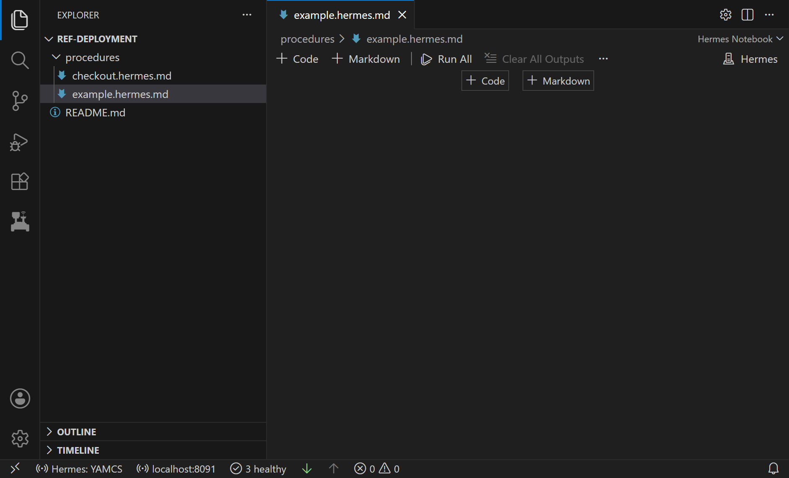
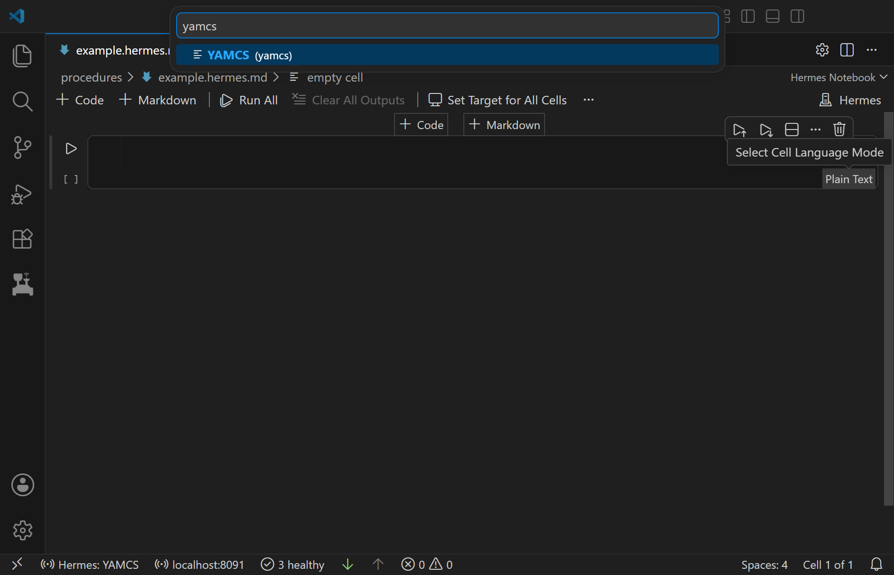

# Notebooks

A Hermes notebook mixes Markdown cells, for notes and instructions, with code cells that send commands to the flight
software. Code cells run once Hermes is [connected to YAMCS](connect.md). Before that, in Offline mode, you can still
write and check them.

## Create a notebook

Create a file whose name ends in one of these. VS Code opens it as a notebook.

| File name ends in | Opens as | VS Code extension | Saved as |
| --- | --- | --- | --- |
| `.hermes.md` | Hermes notebook | Hermes | Markdown that GitHub shows as a document, with each cell's events as a table |
| `.fnb` | F Prime notebook | Hermes FPrime | F Prime sequence text, with everything but the commands in `;` comment lines |



Add a code cell, then click the language name at the bottom right of the cell to pick its language.



| Language to pick | VS Code extension | A cell holds |
| --- | --- | --- |
| **YAMCS** | Hermes | Commands, each named by its [qualified name](../arch/core-concepts.md#yamcs-terms), the command's full path in YAMCS |
| **fprime** | Hermes FPrime | Commands, each named by its F Prime name after a time tag that says when to send it |
| **uplink** | Hermes | Files to [upload](upload-files.md#uplink-cells) |
| **Python** | Hermes | Python code, run by the interpreter selected in the Python extension |
| **Shell Script** | Hermes | Shell commands, run by `bash` |

## YAMCS cells

Write one command per line: its qualified name, then its arguments, separated by spaces or commas. Write a struct
argument as its members' values and an array argument as its elements' values, in order, with no brackets. An F Prime
`bool` is an enumeration in fprime-yamcs, so write it as `True` or `False`. A line starting with `#` is a comment. The
examples on this page use the Ref deployment from the [Quick Start](../getting-started/quick-start.md), whose commands
sit under `/Ref_Ref`.

```
# A no-op, then a no-op that carries a string
/Ref_Ref/CdhCore/cmdDisp/CMD_NO_OP
/Ref_Ref/CdhCore/cmdDisp/CMD_NO_OP_STRING "hello"
```

## F Prime cells

F Prime cells send commands only to YAMCS instances run by
[fprime-yamcs](https://github.com/fprime-community/fprime-yamcs), the tool that runs an F Prime deployment with YAMCS.
Hermes FPrime builds an `<instance> (F Prime)` [dictionary](connect.md#dictionaries) for each one, so cells can use F
Prime command names. A cell that uses an F Prime dictionary from a `build-artifacts` folder can check its commands, but
running it fails with "has no YAMCS qualified name".

```
R00:00:00 CdhCore.cmdDisp.CMD_NO_OP
R00:00:05 CdhCore.cmdDisp.CMD_NO_OP_STRING "hello"   ; waits 5 s after the first command
```

| Part of a line | Example | Meaning |
| --- | --- | --- |
| Time tag, required | `R00:00:05` | Wait this long after the previous command [passes](#run-a-cell), or after the cell starts, then send. The format is `RHH:MM:SS[.sss]`. |
| Command | `CdhCore.cmdDisp.CMD_NO_OP_STRING` | The command's YAMCS path without its top-level part (`/Ref_Ref`), joined with dots. In YAMCS, this one is `/Ref_Ref/CdhCore/cmdDisp/CMD_NO_OP_STRING`. |
| Arguments | `"hello"` | Separated by spaces or commas |
| Comment | `; waits 5 s` | Everything after `;` |

Hermes ignores absolute time tags, such as `A2026-293T12:00:00` for day 293 of 2026. A command with one sends as soon
as the previous command passes.

## Pick a cell target

A cell's target is the YAMCS instance it sends commands to. Hermes names each instance `yamcs:<instance>`, such as
`yamcs:fprime-project` in the Quick Start. The cell's status bar, below its code, shows the target. Click it to pick
another:

| Choice | Target |
| --- | --- |
| Automatic | The only connected instance. A cell on Automatic refuses to run while several instances are connected. |
| Custom | The name you type, such as `yamcs:fprime-project` |
| `yamcs:<instance>` | An instance Hermes is connected to |
| `yamcs:<instance>`, not connected | An instance whose dictionary Hermes saved the last time it connected. The cell can't run until that instance is connected. |

To give every F Prime and YAMCS cell in a notebook the same target, click **Set Target for All Cells** in the
notebook toolbar and pick an instance, connected or not. Cells added afterwards start on Automatic.

A cell checks its commands against a dictionary:

| Cell | Dictionary |
| --- | --- |
| YAMCS cell with a target | `<instance>` |
| F Prime cell with a target | `<instance> (F Prime)` |
| Cell on Automatic | The one [selected](connect.md#pick-a-dictionary) for its language. When YAMCS mode connects, Hermes selects the dictionaries of the first instance YAMCS lists. |

## Run a cell

Click the run button to the left of the cell. The cell checks every line first and sends nothing if one has an error.
Then it sends its commands one at a time, each once the one before it passes, and stops at the first command that
fails. To stop it yourself, click the stop button that takes the run button's place.

Whether a command passes can depend on its verifiers. A verifier is a check YAMCS runs on returning telemetry to decide
whether a command worked.

| When | The command |
| --- | --- |
| YAMCS sends a command that has no verifiers | Passes, even if the flight software then rejects it. fprime-yamcs gives commands no verifiers, so check the cell's events for the flight software's response. |
| The command's verifiers pass | Passes |
| A verifier fails or times out | Fails, with YAMCS's reason |
| YAMCS refuses the command or fails to send it | Fails, with YAMCS's reason |

- Hermes has no timeout of its own. A cell waits as long as YAMCS takes, or until you stop it.
- Stopping a cell doesn't withdraw a command YAMCS already has.
- The check before a run skips the range and length of struct members and array elements. The editor underlines
  such a value, but the cell still sends it.
- **Run All** doesn't stop at a cell that fails. The cells after it still run.

### Command status

While a cell runs, each command's status shows at the end of its line. YAMCS records each step of handling a command,
such as Queued, Released and Sent. Once YAMCS has the command, its status names the newest step.

| Status (example) | Meaning |
| --- | --- |
| `◷ sends in 3.2 s` | Waiting out its time tag |
| `● Sent · 0.4 s` | In flight, with the time so far |
| `✓ completed · 0.1 s` | Passed, with the time it took |
| `✗ failed · EXECUTION_ERROR` | Failed, with YAMCS's reason |
| `○ not sent` | Waiting for the commands before it, or the cell ended before sending it, or YAMCS refused it |
| `? Sent · 1.5 s` | Result unknown: the cell stopped while the command was in flight, or a verifier failed and YAMCS didn't fail the command |

Hover over a status to see each step YAMCS recorded, with its UTC time. The notebook saves the statuses, so they come
back when you reopen it, as long as the command's line is unchanged. Running the cell again clears them.

## Events in a cell's output

While a cell runs, its output lists every event YAMCS reports for the cell's target, including events that other
commands or clients caused. It keeps listing for one second after the last command ends.

- An F Prime event shows its component, name and F Prime [severity](../arch/core-concepts.md#events), such as
  `WARNING_HI`. Any other event, such as one YAMCS raises itself, shows YAMCS's source, type and severity.
- To hide F Prime events of one severity, turn off that severity's setting, such as `hermes.notebook.evrWarningHigh`
  for `WARNING_HI`. Other events always show.
- Times are in UTC. To show local time or an F Prime event's SCLK, set `hermes.notebook.evr.timeFormat` to `local`
  or `sclk`.

To see events outside a cell's run, use the [events panel](telemetry-and-events.md#events-panel).

## Operator signoff

To sign off the steps in a Markdown cell, finish editing the cell and click **Operator Signoff** in its toolbar.
Hermes adds a line like this to the end of the cell:

```
> October 20th 2026, 3:04:05 pm OPERATOR NAME
```

| Setting | Default | Sets |
| --- | --- | --- |
| `hermes.notebook.signoff.name` | `OPERATOR NAME` | The name to sign with |
| `hermes.notebook.signoff.template` | `> {date} {name}` | The line Hermes adds |
| `hermes.notebook.signoff.datetime` | `MMMM Do YYYY, h:mm:ss a` | The [Moment.js format](https://momentjs.com/docs/#/displaying/format/) of `{date}` |
