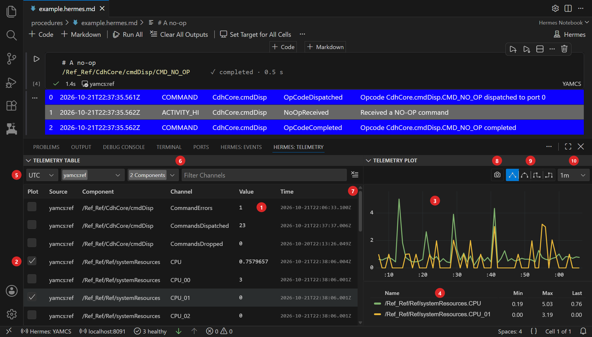
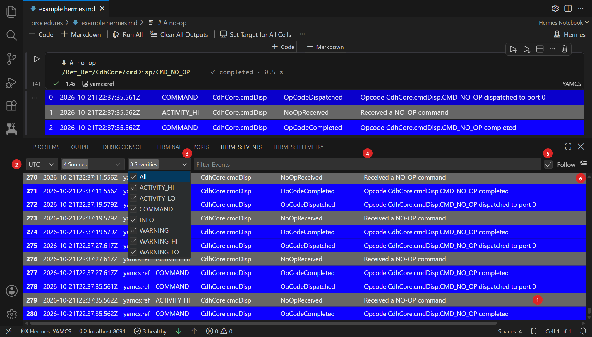

# Telemetry and Events

Hermes adds two tabs to the VS Code panel, where the terminal is: **Hermes: Telemetry** and **Hermes: Events**. In
YAMCS mode they show the telemetry and events of every connected YAMCS instance. Each row's source is its instance.
Once more than one instance is connected, a source filter appears.

## Telemetry table and plot

The table has a row for each [parameter](../arch/core-concepts.md#yamcs-terms), YAMCS's name for a telemetry value
such as an F Prime channel.

- The **Component** column shows the parameter's YAMCS path without its name, such as `/Ref_Ref/CdhCore/cmdDisp`.
  The **Channel** column shows the name, such as `CommandsDispatched`.
- A struct or array gets a row for each member or element, such as `comQueueDepth[1]`.
- A value's time is when YAMCS received it.
- Parameters directly under the top-level path, such as `/Ref_Ref/FPrimeTime`, are left out. fprime-yamcs puts F Prime
  packet header fields there. To show them, set [`includeTopLevel`](connect.md#settings).

| # in the screenshot | Control | What it does |
| --- | --- | --- |
| 1 | Table | Shows each row's newest value |
| 2 | Plot checkbox | Adds a numeric row to the plot |
| 3 | Plot | Plots the checked rows over the time window |
| 4 | Legend | Shows each plotted row's minimum, maximum and last value. Click a row's name to hide its line. |
| 5 | Time format | Picks UTC, Local or SCLK (spacecraft clock). See [Times](#times). |
| 6 | Filters | Shows only some components, or the channels whose name contains the text you type |
| 7 | Clear | Empties the table and plot |
| 8 | Screenshot | Saves the plot as a PNG in the workspace folder |
| 9 | Line style | Draws lines straight, smooth or in one of two step styles |
| 10 | Time window | Shows the last 1m, 5m, 30m, 1h or 3h |

Hermes keeps the newest 10,000 values of each row. The plot draws at most 10 lines, so while 10 are showing, a row
you check is left out of the plot and its legend.

## Events panel

When YAMCS mode connects, the panel lists each instance's newest 100 events from YAMCS's archive, the history YAMCS
stores. With several instances, it lists one instance's archived events, oldest first, then the next instance's. Then
it adds new events as YAMCS reports them.

- An F Prime event shows its component, name and F Prime severity, such as `CdhCore.cmdDisp`, `OpCodeDispatched` and
  `COMMAND`. Any other event, such as one YAMCS raises itself, shows YAMCS's source, type and severity.
- An F Prime event's time is when the flight software raised it.

| # in the screenshot | Control | What it does |
| --- | --- | --- |
| 1 | Event list | Lists the events that pass the filters |
| 2 | Time format | Picks UTC, Local or SCLK. See [Times](#times). |
| 3 | Severities | Shows only the [severities](../arch/core-concepts.md#events) you check |
| 4 | Filter | Shows only the events whose message contains the text you type |
| 5 | Follow | Scrolls to each new event |
| 6 | Clear | Empties the list |

## Times

The table, the plot and the events panel show times in UTC. You can switch the table and the panel to Local or SCLK.

| Row | UTC or Local | SCLK, in seconds |
| --- | --- | --- |
| Telemetry value | When YAMCS received it, its [Earth received time](../arch/core-concepts.md#earth-received-time) (ERT) | The flight software's clock reading from the packet that carried it. Blank until the value updates after Hermes connects. |
| F Prime event | When the flight software raised it | The flight software's clock reading from when it raised it |
| Other event | When it was raised | Blank |

fprime-yamcs dates each F Prime packet by reading the packet's time tag as Unix time, and ignores the tag's time
base. So an F Prime event's UTC and Local times are right only if the flight software's clock counts from 1970.
