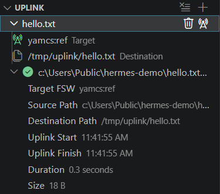

# Upload Files

Once Hermes is [connected to YAMCS](connect.md), it can send a file to the flight software of an instance that
fprime-yamcs runs. You can upload from the **Uplink** view in the Hermes sidebar, or from a notebook cell. Hermes hands
the file to YAMCS, and fprime-yamcs sends it to the spacecraft.

## Uplink view

To open the Hermes sidebar, click the Hermes icon, a rover, in the activity bar on the left. The Uplink view is below
**Connections**.



1. Click **+** at the top of the Uplink view and pick a file.
2. Hover over **Destination**, click its pencil, and type the path to save the file to on the spacecraft.
3. Hermes picks the first instance that can upload as the **Target**. To pick another, hover over it and click its
   pencil.
4. Click the file's **Uplink File** button, the radio tower next to its trash can.

Once the upload ends, the view lists the file with a check mark, or with a cross if it failed. Expand it to see its
target, paths, start and finish times, duration and size, and the error if it failed. The list lasts until you click
**Clear Uplink Listing**, the button left of **+**, or Hermes disconnects from YAMCS.

## Uplink cells

To upload from a notebook, [add a code cell](notebooks.md#create-a-notebook) and pick **uplink** as its language. Write
one file per line, as `<target> <file> <destination>`. The target is the instance's name, and a relative `<file>` is
relative to the first workspace folder. Paths can't contain spaces, even in quotes. For the Ref deployment from the
[Quick Start](../getting-started/quick-start.md):

```
fprime-project hello.txt /tmp/uplink/hello.txt
```

The cell uploads its files one after another and shows each one's progress in a notification. The Uplink view lists
each upload once it ends.

## Compiled sequences

In an [F Prime cell](notebooks.md#f-prime-cells), the file argument of `CS_RUN` and `CS_VALIDATE` completes from the
workspace's `.seq` files. Picking the one for `foo.seq` inserts `"/seq/foo.bin"`, the path Hermes assumes the compiled
sequence has on the spacecraft. Running the command doesn't compile or upload it. Compile it with
`fprime-seqgen --dictionary <dictionary> foo.seq foo.bin`, [upload](#uplink-cells) `foo.bin` to that path, and set
`hermes.fprime.sequenceUplinkRoot` if the folder isn't `/seq`, such as `/tmp/uplink` for the Ref deployment.

## Limits

- A finished upload means fprime-yamcs sent every packet. F Prime's `FileReceived` event, in the
  [events panel](telemetry-and-events.md#events-panel), tells you the flight software saved the file.
- The deployment decides which destination paths it accepts. The Ref deployment saves files only under `/tmp/uplink/`.
- Files over about 4 MiB fail, because they exceed the yamcs-grpc plugin's default gRPC message size.
- fprime-yamcs sends one file at a time, at about 20 KiB/s.
- You can't cancel an upload. Stopping an uplink cell skips its remaining files, but fprime-yamcs still sends the one in
  progress, and the Uplink view lists it once YAMCS finishes sending it.
