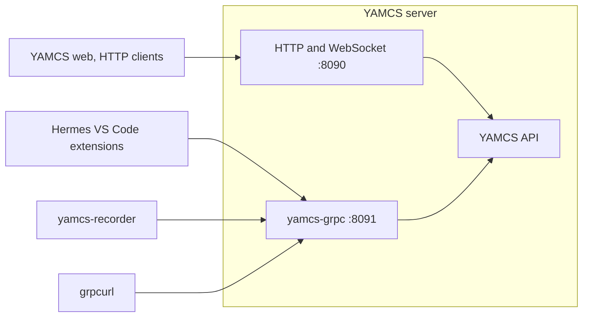

# yamcs-grpc

A YAMCS plugin that serves YAMCS's API over gRPC, a protocol for calling a server's methods. It uses YAMCS's own
`.proto` files, which define the API's messages and methods, and sends each call to the same YAMCS code that answers
HTTP and WebSocket requests. The [Hermes VS Code extensions](../src/extensions/core/README.md#yamcs-mode) and
[yamcs-recorder](../cmd/yamcs-recorder/README.md) connect to YAMCS through it.



## Build

From `yamcs-grpc-plugin/`, with Docker, curl and a POSIX shell (Git Bash or WSL on Windows):

```sh
./build.sh
```

It compiles the plugin against YAMCS 5.13.5 inside the `yamcs/example-simulation` Docker image, and puts the plugin
jar and the gRPC jars it needs in `out/lib/`.

The unit tests are optional. They need Maven 3.9+ and Java 17+, but no YAMCS server:

```sh
mvn test
```

`pom.xml` gives `mvn test` and IDEs the same YAMCS and gRPC versions as `build.sh`, so change both together.

## Run

YAMCS loads the plugin at startup from the jars in `out/lib/`, with no `yamcs.yaml` entry, and logs
`gRPC API listening on port 8091`.

### With fprime-yamcs

[fprime-yamcs](https://github.com/fprime-community/fprime-yamcs) runs YAMCS for an F Prime deployment, with a YAMCS
instance called `fprime-project`. Install it with `pip install fprime-yamcs`, then add `--yamcs-plugin-jars` when you
start it from your deployment's directory:

```sh
# <hermes> is your Hermes clone. Add any other fprime-yamcs options as usual.
fprime-yamcs --yamcs-plugin-jars <hermes>/yamcs-grpc-plugin/out/lib
```

fprime-yamcs 0.2.3 and 0.2.4 both bundle YAMCS 5.12.8. The plugin was tested with 0.2.3.

### With stock YAMCS

To try Hermes without F Prime, run YAMCS's demo image. Its one instance, `simulator`, gets telemetry from a simulated
spacecraft. YAMCS loads every jar in its `lib/ext` directory, so mount `out/lib` there. From `yamcs-grpc-plugin/`:

```sh
# pwd -W gives Docker a Windows path under Git Bash
docker run -d --name yamcs-grpc -p 8090:8090 -p 8091:8091 \
    -v "$(pwd -W 2>/dev/null || pwd)/out/lib:/opt/yamcs/lib/ext:ro" yamcs/example-simulation:5.13.5
```

## Configure

The plugin listens on port 8091. To change it, add a `yamcs-grpc` section to the server's
`yamcs.yaml`, for example:

```yaml
yamcs-grpc:
  port: 8095
```

- With fprime-yamcs, that file is `etc/yamcs.yaml` in the directory you pass to `--yamcs-config-dir`. If you don't
  have one yet, copy fprime-yamcs's built-in one with fprime-yamcs's Python environment active:

  ```sh
  config=$(python -c "from importlib.resources import files; print(files('fprime_yamcs') / 'yamcs/src/main/yamcs')")
  cp -r "$config" yamcs-config
  ```

  Then pass `--yamcs-config-dir yamcs-config` along with `--yamcs-plugin-jars`.

- With YAMCS security on, a client must send the same Basic or Bearer `authorization` header as for HTTP. Hermes
  and yamcs-recorder send none.

## Try it

With the stock YAMCS container above running, this streams the simulator's battery voltage with
[grpcurl](https://github.com/fullstorydev/grpcurl), a command-line gRPC client you install separately. grpcurl reads
YAMCS's `.proto` files from [`proto/yamcs/`](../proto/yamcs/README.md), so run it from the repository root:

```sh
grpcurl -plaintext -import-path proto -proto yamcs/protobuf/processing/processing.proto \
    -d '{"instance":"simulator","processor":"realtime","id":[{"name":"/YSS/SIMULATOR/BatteryVoltage1"}]}' \
    localhost:8091 yamcs.protobuf.processing.ProcessingApi/SubscribeParameters
```

## Limits

| Limit | Effect |
| --- | --- |
| No TLS, and it listens on every network interface | Traffic is unencrypted, and any machine that can reach the port can connect |
| Slow clients are cut off | A client more than 8 MiB behind on a stream gets a `RESOURCE_EXHAUSTED` error |
| Requests are limited to 4 MiB, gRPC's default | A larger request, such as a Hermes upload of a file over about 4 MiB, fails with a `RESOURCE_EXHAUSTED` error |
| Missing from YAMCS's connection list | `/api/http-traffic`, YAMCS's list of client connections, shows only HTTP clients |
| No `SessionsApi/SubscribeSession` | That call fails with an `INTERNAL` error. Hermes doesn't use it. |
| Relies on a YAMCS class that isn't public API | A YAMCS upgrade that changes it could break the plugin |
