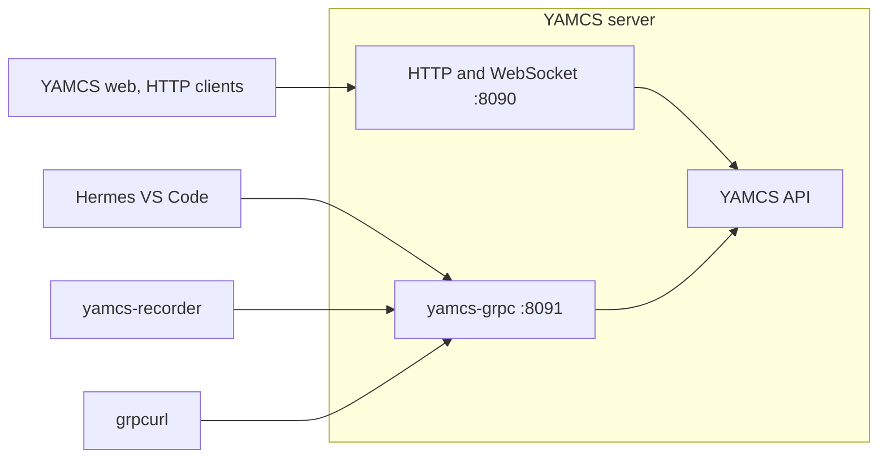

# yamcs-grpc

A YAMCS plugin that serves YAMCS's API over gRPC, using YAMCS's own `.proto` service definitions.
Each call goes to the same YAMCS code that answers HTTP and WebSocket requests. The
[Hermes VS Code extension](../src/extensions/core/README.md#yamcs-mode) and
[yamcs-recorder](../cmd/yamcs-recorder/README.md) connect to YAMCS through it.



## Build

From `yamcs-grpc-plugin/`:

```sh
./build.sh   # needs Docker, curl and a POSIX shell (Git Bash or WSL on Windows)
mvn test     # unit tests, which need Maven 3.9+ and Java 17+ but no YAMCS server
```

- `out/lib/` then holds the plugin jar and the gRPC jars it needs.
- `build.sh` compiles against YAMCS 5.13.5, inside the `yamcs/example-simulation` image.
- `pom.xml` declares the same YAMCS and gRPC versions for IDEs and `mvn test`. Keep them in sync with
  `build.sh`.

## Run

YAMCS loads the plugin from its classpath at startup, without a `yamcs.yaml` entry, and logs
`gRPC API listening on port 8091`.

### With fprime-yamcs

[fprime-yamcs](https://github.com/fprime-community/fprime-yamcs) runs YAMCS for an F Prime deployment
and installs with `pip install fprime-yamcs`. The plugin was tested with 0.2.3, which bundles YAMCS
5.12.8.

```sh
# Add --yamcs-plugin-jars to the arguments you start fprime-yamcs with
fprime-yamcs ... --yamcs-plugin-jars <repo>/yamcs-grpc-plugin/out/lib
```

### With stock YAMCS

YAMCS puts every jar in its `lib/ext` directory on its classpath, so mount `out/lib` there. For
example, with the example-simulation image, from `yamcs-grpc-plugin/`:

```sh
# pwd -W gives Docker a Windows path under Git Bash
docker run -d --name yamcs-grpc -p 8090:8090 -p 8091:8091 \
    -v "$(pwd -W 2>/dev/null || pwd)/out/lib:/opt/yamcs/lib/ext:ro" yamcs/example-simulation:5.13.5
```

## Configure

The plugin listens on port 8091. To change it, add a `yamcs-grpc` section to the server's
`yamcs.yaml`, for example:

```yaml
yamcs-grpc:
  port: 8095
```

- With fprime-yamcs, that file is `etc/yamcs.yaml` in the directory you pass to `--yamcs-config-dir`.
- With YAMCS security on, a client must send the same Basic or Bearer `authorization` header as for HTTP. Hermes
  and yamcs-recorder send none.

## Try it

With the stock YAMCS container above running, this streams the simulator's battery voltage. The
plugin has no gRPC server reflection, so grpcurl reads YAMCS's `.proto` files from
[`proto/yamcs/`](../proto/yamcs/README.md). Run it from the repo root.

```sh
grpcurl -plaintext -import-path proto -proto yamcs/protobuf/processing/processing.proto \
    -d '{"instance":"simulator","processor":"realtime","id":[{"name":"/YSS/SIMULATOR/BatteryVoltage1"}]}' \
    localhost:8091 yamcs.protobuf.processing.ProcessingApi/SubscribeParameters
```

## Limits

| Limit | What you see |
| --- | --- |
| No TLS, listens on every interface | Traffic is unencrypted, and any machine that can reach the port can connect |
| Slow clients are cut off | A client more than 8 MiB behind on a stream gets `RESOURCE_EXHAUSTED` |
| Not in YAMCS's connection list | `/api/http-traffic` lists only HTTP connections |
| No `SessionsApi/SubscribeSession` | It fails with `INTERNAL` |
| Tied to a YAMCS internal | A YAMCS upgrade could break the plugin |
